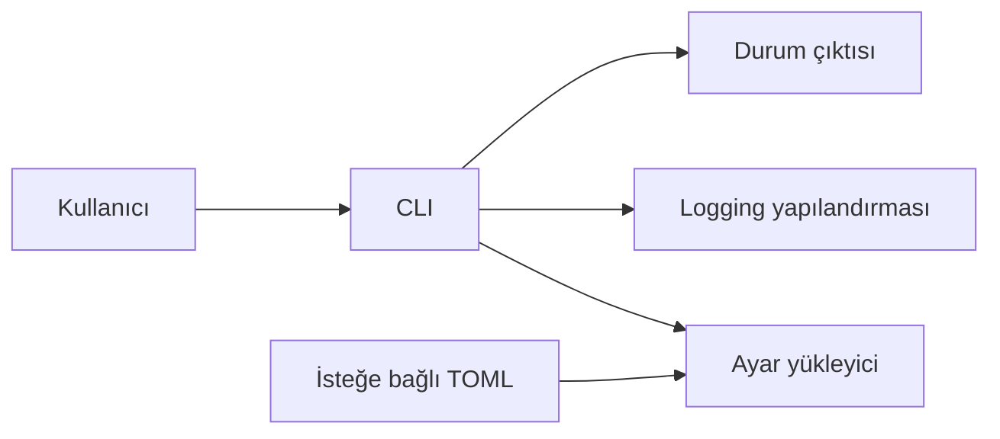
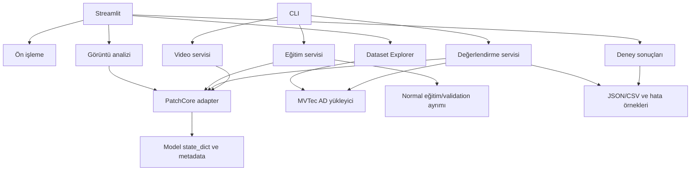

# Mimari

Industrial Vision AI aşamalı geliştirilen bir modüler monolittir. Paket içindeki
modüller aynı süreçte çalışır. Her katmanın sorumluluğu, ihtiyaç ortaya çıktıkça
ayrı modüllerle uygulanır.

## Phase 0 bileşenleri

| Bileşen | Sorumluluk |
| --- | --- |
| `cli.main()` | Komut satırı argümanlarını okur, ayarları yükler ve durum çıktısını gösterir. |
| `config.load_config()` | Yerleşik varsayılanları döndürür veya verilen TOML dosyasını okuyup doğrular. |
| `ApplicationConfig` | Doğrulanmış ayarları değiştirilemez bir veri nesnesinde taşır. |
| `infrastructure.logging_config.configure_logging()` | Standart hata akışı için log seviyesi ve biçimini ayarlar. |

CLI, yapılandırma ve logging modüllerini çağırır. Bu modüller CLI'a bağımlı
değildir. Paket import edildiğinde dosya okunması veya logging kurulumu
tetiklenmez. `--config` yolu çalışma dizinine göre çözümlenir ve hata durumunda
CLI açıklayıcı bir mesajla çıkar.

## Hedef katmanlar

| Katman | Sorumluluk |
| --- | --- |
| Presentation | CLI ve Streamlit üzerinden kullanıcı girdisi, sonuç gösterimi ve dışa aktarma. |
| Application | Görüntü doğrulama, ön işleme, analiz ve sonuç üretimi iş akışını koordine etme. |
| Domain | Analiz ayarları, görüntü bilgisi, kusur bölgeleri ve sonuç veri tipleri. |
| Infrastructure | Görüntü ve veri kümesi dosyaları, sonuç depolama ve logging. |
| Machine Learning | Model eğitimi, model yükleme ve tahmin. |

Planlanan analiz akışında sunum katmanı uygulama katmanını çağırır. Uygulama
katmanı alan veri tiplerini, görüntü işleme fonksiyonlarını ve analiz
bileşenlerini kullanır. Domain, Streamlit'ten bağımsız kalır. Analiz
iş akışı, girdi doğrulamadan başlayarak ön işleme, analiz, son işleme ve
görselleştirme adımlarıyla sonuç nesnesini üretir.

Phase 2'de referanslı görsel fark analizi somut bir bileşen olarak eklenecek.
Ortak detector arayüzü, birden fazla yöntem uygulama katmanında aynı
sözleşmeyi kullanmaya başladığında şekillenecek. Model aşamasında eğitim
CLI üzerinden yürütülecek. Model dosyası ve metadata ayrı saklanacak.
Tahmin iş akışı kayıtlı modeli yükleyerek anomali haritası ve görüntü
düzeyinde skor üretecek.

## Phase 2 uygulaması

CLI demo → SyntheticDatasetGenerator → InspectionService → ReferenceDifferenceDetector → draw_regions → InspectionArtifacts → save_inspection.

Domain dataclass nesneleri yapılandırma, bölgeler ve JSON raporunu taşır. Büyük NumPy dizileri InspectionArtifacts içinde tutulur ve PNG olarak kaydedilir. Detector, UI ve dosya sisteminden bağımsızdır. Repository dosyaları geçici bir dizinde hazırlar, tamamlanan analiz dizinini benzersiz ID altında yayımlar. Girdi dosya adı yalnızca raporda saklanır. Sentetik ground truth detector tarafından kullanılmaz.

## Phase 3 veri akışı

Streamlit Dataset Explorer → DatasetLoader.scan → DatasetIndex → istatistikler ve bütünlük hataları. Seçilen DatasetSample, load_sample üzerinden RGB görüntü ve binary ground truth sağlar. Loader mevcut image_loader doğrulamasını kullanır. DatasetSample resmî split, kusur türü ve maskenin yolunu taşır. Dosyalar sıralanarak deterministik listeleme yapılır. Tarama sonucu oturuma özgü session_state içinde tutulur; farklı kök veya kategori seçildiğinde eski sonuç gösterilmez. Normal maskeler görüntü boyutunda sıfır olarak oluşturulur.

## Phase 4 model akışı

ml_cli → training_service.train → split_normal → PatchCoreDetector → Anomalib PatchcoreModel. Bölme yalnızca bottle/train/good yollarını kullanır. Training service normal özellikleri toplar, Anomalib coreset seçimini çağırır ve ayrılmış normal validation skorlarından eşik üretir. Model ve metadata geçici dizinde hazırlanıp benzersiz model dizinine taşınır. Tahmin komutu bu state_dict'i yeniden yükleyip görüntü skoru ve orijinal çözünürlükte sürekli anomali haritası üretir. Ağır bağımlılıklar yalnızca ML giriş noktasında yüklenir.

## Phase 5 değerlendirme

ml_cli evaluate → evaluation_service → DatasetLoader ve PatchCoreDetector → binary_metrics → JSON/CSV ve örnek PNG çıktıları. Veri bütünlüğü hatalarında değerlendirme durur. Eğitim/validation manifestlerinin ayrıklığı ve normal eğitim dizini içinde bulunması doğrulanır. Piksel kalibrasyonu yalnızca normal validation üzerinde yapılır. Test döngüsü görüntü ve piksel skorlarını karşılaştırır. Tamamlanan rapor geçici dizinden benzersiz çalışma dizinine yayımlanır.

## Phase 5 değerlendirme akışı

ML CLI evaluate → evaluation_service → kayıtlı PatchCore modeli ve DatasetLoader. Normal validation manifesti eğitimle çakışma ve kategori dışına çıkma açısından doğrulanır. Görüntü eşiği model metadata dosyasından alınır, piksel eşiği normal validation haritalarından hesaplanır. Test sonuçları ardından tek seferde ölçülür. Metrikler scikit-learn ile hesaplanır. Tamamlanan raporlar benzersiz run dizinine taşınır. JSON null ve CSV N/A tanımsız metrikleri belirtir.

## Phase 6 sunum katmanı

Image Inspection → model_inspection.inspect_upload → PatchCoreDetector. Model oturuma özgü session_state içinde model yolu, cihaz ve model dosyasının değişiklik zamanı ile tutulur. Analiz çıktısı yüklenen dosyanın SHA256 değeriyle eşleştirilir. Geçici dosya tahmin tamamlandığında kaldırılır. PNG ve NPY export uygulama modülündedir. Experiment Results kayıtlı raporları salt okunur açar.

## Phase 7 video akışı

ML CLI video → realtime_service.run_video → OpenCV VideoCapture → BGR/RGB dönüşümü → PatchCoreDetector.predict_rgb → skor ve overlay. predict(path) aynı RGB tahmin yolunu kullanır. Senkron döngü warm-up, ölçüm, kullanıcı çıkışı ve finally içinde capture/pencere kapatılmasını yönetir. JSON ölçümleri CLI tarafından benzersiz dosyada saklanır. Fiziksel kamera buffer kayıpları ölçülemediğinden null olarak bildirilir.

## Uygulanan sistem

