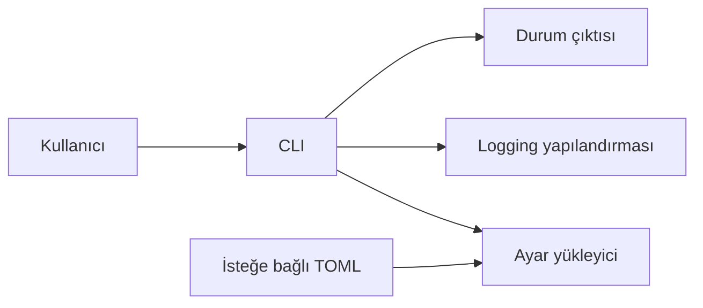

# Mimari

Industrial Vision AI aşamalı geliştirilen bir modüler monolittir. Paket içindeki
modüller aynı süreçte çalışır. Her katmanın sorumluluğu, ihtiyaç ortaya çıktıkça
ayrı modüllerle uygulanır.

## Phase 0 bileşenleri

| Bileşen | Sorumluluk |
| --- | --- |
| `cli.main()` | Komut satırı argümanlarını okur, ayarları yükler ve durum çıktısını gösterir. |
| `config.load_config()` | Yerleşik varsayılanları döndürür veya verilen TOML dosyasını okuyup doğrular. |
| `ApplicationConfig` | Doğrulanmış ayarları değiştirilemez bir veri nesnesinde taşır. |
| `infrastructure.logging_config.configure_logging()` | Standart hata akışı için log seviyesi ve biçimini ayarlar. |

CLI, yapılandırma ve logging modüllerini çağırır. Bu modüller CLI'a bağımlı
değildir. Paket import edildiğinde dosya okunması veya logging kurulumu
tetiklenmez. `--config` yolu çalışma dizinine göre çözümlenir ve hata durumunda
CLI açıklayıcı bir mesajla çıkar.

## Hedef katmanlar

| Katman | Sorumluluk |
| --- | --- |
| Presentation | CLI ve Streamlit üzerinden kullanıcı girdisi, sonuç gösterimi ve dışa aktarma. |
| Application | Görüntü doğrulama, ön işleme, analiz ve sonuç üretimi iş akışını koordine etme. |
| Domain | Analiz ayarları, görüntü bilgisi, kusur bölgeleri ve sonuç veri tipleri. |
| Infrastructure | Görüntü ve veri kümesi dosyaları, sonuç depolama ve logging. |
| Machine Learning | Model eğitimi, model yükleme ve tahmin. |

Planlanan analiz akışında sunum katmanı uygulama katmanını çağırır. Uygulama
katmanı alan veri tiplerini, görüntü işleme fonksiyonlarını ve analiz
bileşenlerini kullanır. Domain, Streamlit'ten bağımsız kalır. Analiz
iş akışı, girdi doğrulamadan başlayarak ön işleme, analiz, son işleme ve
görselleştirme adımlarıyla sonuç nesnesini üretir.

Phase 2'de referanslı görsel fark analizi somut bir bileşen olarak eklenecek.
Ortak detector arayüzü, birden fazla yöntem uygulama katmanında aynı
sözleşmeyi kullanmaya başladığında şekillenecek. Model aşamasında eğitim
CLI üzerinden yürütülecek. Model dosyası ve metadata ayrı saklanacak.
Tahmin iş akışı kayıtlı modeli yükleyerek anomali haritası ve görüntü
düzeyinde skor üretecek.

## Phase 2 uygulaması

CLI demo → SyntheticDatasetGenerator → InspectionService → ReferenceDifferenceDetector → draw_regions → InspectionArtifacts → save_inspection.

Domain dataclass nesneleri yapılandırma, bölgeler ve JSON raporunu taşır. Büyük NumPy dizileri InspectionArtifacts içinde tutulur ve PNG olarak kaydedilir. Detector, UI ve dosya sisteminden bağımsızdır. Repository dosyaları geçici bir dizinde hazırlar, tamamlanan analiz dizinini benzersiz ID altında yayımlar. Girdi dosya adı yalnızca raporda saklanır. Sentetik ground truth detector tarafından kullanılmaz.
